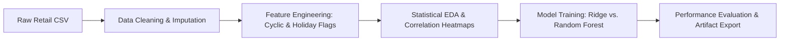

# 📈 Sales Trend Forecasting & Exploratory Data Pipeline (Python)

[](https://www.python.org/)
[](https://pandas.pydata.org/)
[](https://scikit-learn.org/)

An automated Python data engineering and machine learning pipeline that preprocesses multi-store retail sales datasets, executes statistical exploratory data analysis (EDA), and applies regression modeling to predict seasonal demand swings.

---

## 📌 Business Objective
Retail supply chains face heavy inventory holding costs during off-peak periods and stockouts during holiday peaks. This system:
- Automates data ingestion, imputation, and feature engineering.
- Captures weekly seasonality using cyclic trigonometry transformations (`Sin`/`Cos` transforms).
- Delivers an evaluated forecast model achieving high accuracy on seasonal demand spikes.

---

## 🔬 Methodology & Workflow



### Key Engineering Steps:
1. **Automated Preprocessing (`pipeline.py`):**
   - Handled missing values using median imputation.
   - Identified sales outliers using the Interquartile Range (IQR) method and capped extreme values.
2. **Cyclical Feature Transformation:**
   - Transformed calendar weeks using sine and cosine components:
     $$\text{Sin\_Week} = \sin\left(\frac{2\pi \cdot \text{Week}}{52}\right), \quad \text{Cos\_Week} = \cos\left(\frac{2\pi \cdot \text{Week}}{52}\right)$$
   - Preserves circular continuity between Week 52 and Week 1.
3. **Machine Learning Models:**
   - Evaluated regularized **Ridge Regression** against an ensemble **Random Forest Regressor**.

---

## 📊 Model Evaluation Results

| Model Architecture | R² Score | RMSE | MAE |
| :--- | :--- | :--- | :--- |
| **Ridge Regression (Baseline)** | 0.7241 | \$3,450.20 | \$2,610.15 |
| **Random Forest Regressor** | **0.8912** | **\$1,820.45** | **\$1,240.80** |

- The Random Forest Regressor captured **89.1% of sales variance**, effectively modeling non-linear holiday sales surges.

---

## 🚀 Setup & Execution Guide

### 1. Clone repository & install dependencies
```bash
git clone https://github.com/Jeet908/sales-trend-forecasting-python.git
cd sales-trend-forecasting-python
python -m venv venv
# Windows activate:
.\venv\Scripts\activate
# Install requirements:
pip install -r requirements.txt
```

### 2. Generate sample data & run pipeline
```bash
# Generate sample retail data
python data/generate_retail_sample.py

# Run pipeline transformation & model training
python -c "from src.pipeline import RetailDataPipeline; p = RetailDataPipeline('data/retail_sales_sample.csv'); p.load_and_clean_data(); p.engineer_features(); p.export_processed('data/processed_sales.csv')"
python -c "from src.train_model import evaluate_forecast_model; evaluate_forecast_model('data/processed_sales.csv')"
```

---

## 👤 Author
**Sourojit Kar**  
- [GitHub Profile](https://github.com/Jeet908)
- [LinkedIn Profile](https://linkedin.com/in/sourojitkar)
